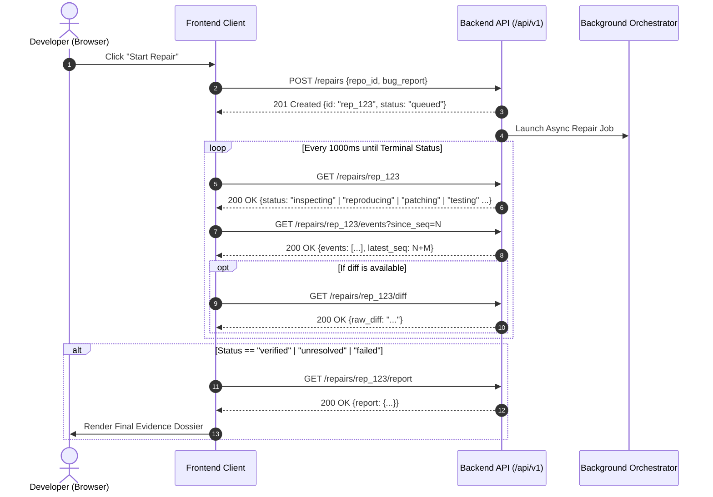

# PatchPilot — REST API Contract Specification

**Document Version:** 1.0.0-freeze  
**Status:** Approved Architecture Baseline  
**Base Path:** `/api/v1`  
**Data Format:** `application/json; charset=utf-8`  
**Time Format:** ISO 8601 UTC (`YYYY-MM-DDTHH:MM:SS.sssZ`)  

---

## 1. Global Conventions & Standards

### 1.1 Content Types & Serialization
All requests and responses use JSON encoding. All dates and times are serialized as strict UTC ISO 8601 strings (e.g. `2026-10-12T17:37:04.123Z`).

### 1.2 Authentication, BYOK Lifecycle & Secret Redaction
* **No User Accounts:** PatchPilot runs locally in single-user mode.
* **Frontend Session Retention:** The user enters their Gemini API key into the frontend modal, where it is retained strictly in React session component memory (never written to `localStorage`, `sessionStorage`, or cookies).
* **Transmission Protocol:** The key is transmitted only to the local backend over the configured loopback connection (`127.0.0.1`) via the HTTP header:
  `X-Session-Gemini-Key: <api-key>`
  Alternatively, the backend reads `GEMINI_API_KEY` from the host environment.
* **Active Validation Requirement:** A user-submitted key is never assumed valid merely because it was submitted; it must pass active validation via `POST /api/v1/provider/session-key`.
* **Redaction Invariant:** Keys are never echoed back in response payloads, headers, error traces, or audit events.

### 1.3 Local Loopback API Protections
* **Loopback Transport Notice:** Local HTTP traffic over loopback (`127.0.0.1`) is not encrypted with TLS.
* **Host Binding:** The backend binds strictly to `127.0.0.1` and explicitly avoids listening on all interfaces (`0.0.0.0`).
* **Narrow CORS Enforcement:** The backend enforces strict Cross-Origin Resource Sharing (CORS) rules, allowing requests only from the local developer frontend (`http://localhost:5173` and `http://127.0.0.1:5173`). Requests from arbitrary external web origins are rejected.
* **Host Header Validation:** The backend validates incoming `Host` headers to prevent DNS rebinding attacks across local browser tabs.
* **Path Privacy Invariant:** Absolute host filesystem paths are internal backend state and are strictly omitted from frontend API payloads to prevent information disclosure.

### 1.4 PatchPilot Standard API Error Envelope (Custom Format)
Every non-2xx response returns a uniform `APIError` payload structured for predictable frontend client parsing, error badge mapping, and UI toasts (this is PatchPilot's internal structured error schema, not RFC 7807 Problem Details):

```json
{
  "error": {
    "code": "RESOURCE_NOT_FOUND",
    "message": "The requested repair job 'rep_9b1deb4d3b7d489e' does not exist.",
    "details": {
      "resource_id": "rep_9b1deb4d3b7d489e",
      "resource_type": "repair"
    },
    "timestamp": "2026-10-12T17:37:04.123Z"
  }
}
```

#### Standard Error Codes:
* `INVALID_REQUEST`: Malformed JSON or schema constraint failure (HTTP 422 / 400).
* `RESOURCE_NOT_FOUND`: Target repository or repair ID does not exist (HTTP 404).
* `CONFLICT_STATE`: Action invalid for current lifecycle state (HTTP 409).
* `PATH_TRAVERSAL_DETECTED`: Security violation; path leaves authorized root (HTTP 403).
* `PROVIDER_KEY_MISSING`: No Gemini key available via header or environment (HTTP 401).
* `PROVIDER_AUTH_FAILED`: Gemini API rejected the supplied key (HTTP 401).
* `PROVIDER_QUOTA_EXHAUSTED`: Gemini API rate limit or quota exceeded (HTTP 429).
* `PROVIDER_MODEL_UNAVAILABLE`: Configured Gemini model is not found, deprecated, or unavailable (HTTP 404).
* `PROVIDER_ERROR`: External model service error or timeout (HTTP 502 / 504).
* `SANDBOX_UNAVAILABLE`: Docker/image unavailable and target is an untrusted/arbitrary repository (HTTP 412).
* `INTERNAL_ERROR`: Unexpected internal exception (HTTP 500).

---

## 2. Core Enumerations

### 2.1 `RepairStatus`
```json
[
  "queued",
  "inspecting",
  "reproducing",
  "patching",
  "testing",
  "verifying",
  "recovering",
  "verified",
  "unresolved",
  "failed",
  "cancelled"
]
```

### 2.2 `Language`
```json
[
  "python",
  "javascript",
  "typescript",
  "java",
  "unknown"
]
```

### 2.3 `TestFramework`
```json
[
  "pytest",
  "vitest",
  "jest",
  "maven_junit",
  "gradle_junit",
  "unknown"
]
```

### 2.4 `AuditEventType`
```json
[
  "state_transition",
  "tool_invocation",
  "tool_result",
  "diff_generated",
  "test_execution_started",
  "test_execution_completed",
  "recovery_triggered",
  "verification_verdict",
  "error_encountered"
]
```

### 2.5 `VerificationOutcome`
```json
[
  "verified",
  "unresolved",
  "failed"
]
```

---

## 3. Detailed Endpoint Specifications

### 3.1 System & Provider Endpoints

---

#### `GET /api/v1/health`
Checks backend process health, SQLite connectivity, and sandbox runner status (including 3-way Docker feasibility: CLI, daemon, and image).

* **Method:** `GET`
* **Path:** `/api/v1/health`
* **Request:** None
* **Response (HTTP 200 OK):**
```json
{
  "status": "healthy",
  "version": "1.0.0",
  "timestamp": "2026-10-12T17:37:04.123Z",
  "environment": {
    "python_version": "3.12.2",
    "sandbox_backend": "docker",
    "docker_cli_available": true,
    "docker_daemon_responsive": true,
    "sandbox_image_available": true,
    "restricted_mode": false,
    "active_model": "gemini-2.0-flash",
    "database_connected": true
  }
}
```

---

#### `GET /api/v1/provider/status`
Validates whether a Gemini API key is configured, identifies the active model candidate, and conducts a lightweight provider ping.

* **Method:** `GET`
* **Path:** `/api/v1/provider/status`
* **Headers:**
  * `X-Session-Gemini-Key` (Optional, string): In-memory key to validate.
* **Note on Model & Quotas:** The model is configured via `GEMINI_MODEL` (default candidate: `gemini-2.0-flash`). Model names in examples represent default candidates, not permanent availability guarantees. Free tier quotas are subject to provider rate limits (e.g. 15 RPM) and are not assumed to be unlimited.
* **Response (HTTP 200 OK):**
```json
{
  "configured": true,
  "source": "session_header",
  "model": "gemini-2.0-flash",
  "connection_valid": true,
  "error_message": null,
  "privacy_notice": "Code snippets and bug descriptions are transmitted over TLS to Google Gemini API. Repository contents are subject to provider data policies."
}
```
* **Response (HTTP 200 OK - Not Configured):**
```json
{
  "configured": false,
  "source": "none",
  "model": "gemini-2.0-flash",
  "connection_valid": false,
  "error_message": "No API key found in session or GEMINI_API_KEY environment variable.",
  "privacy_notice": "Code snippets and bug descriptions are transmitted over TLS to Google Gemini API. Repository contents are subject to provider data policies."
}
```

---

#### `POST /api/v1/provider/session-key`
Conducts an active validation test of the user-supplied session key against the Gemini API. Does **not** persist the key to disk or database. A key is never assumed valid without passing this check.

* **Method:** `POST`
* **Path:** `/api/v1/provider/session-key`
* **Request Body:**
```json
{
  "api_key": "YOUR_GEMINI_API_KEY"
}
```
* **Validation:** String length between 20 and 128 characters.
* **Response (HTTP 200 OK - Valid Key):**
```json
{
  "valid": true,
  "model_available": "gemini-2.0-flash",
  "message": "Connection established successfully."
}
```
* **Error Response (HTTP 401 Unauthorized - Invalid Key):**
```json
{
  "error": {
    "code": "PROVIDER_AUTH_FAILED",
    "message": "Gemini API rejected the key: API key not valid.",
    "details": {},
    "timestamp": "2026-10-12T17:37:04.123Z"
  }
}
```

---

### 3.2 Repository Endpoints

---

#### `GET /api/v1/repositories`
Lists authorized local repositories available for repair.

* **Method:** `GET`
* **Path:** `/api/v1/repositories`
* **Security Notice:** Absolute host filesystem paths (`root_path`) are internal backend state and are strictly omitted from responses to prevent local path disclosure.
* **Response (HTTP 200 OK):**
```json
{
  "items": [
    {
      "id": "repo_py_calc_01",
      "name": "python_calc_bug",
      "language": "python",
      "test_framework": "pytest",
      "layout_status": "valid",
      "execution_allowed": true,
      "execution_warning": null,
      "is_fixture": true,
      "created_at": "2026-10-12T17:00:00.000Z"
    }
  ],
  "total": 1
}
```

---

#### `POST /api/v1/repositories/open-local`
Registers a user-selected local directory as an authorized repository. Supports Python, TypeScript, JavaScript, and Java projects with or without existing tests.

* **Method:** `POST`
* **Path:** `/api/v1/repositories/open-local`
* **Request Body:**
```json
{
  "path": "C:\\Users\\dev\\projects\\my_app"
}
```
* **Security Check:** Validates canonical path, rejects system roots, protected directories, path traversal, and symlink escapes.
* **Response (HTTP 200 OK - Project with Tests):**
```json
{
  "id": "repo_local_5c85ed0b",
  "name": "my_app",
  "language": "python",
  "test_framework": "pytest",
  "layout_status": "valid",
  "execution_allowed": false,
  "execution_warning": "Docker sandbox unavailable on host. Execution blocked for security; source inspection and test proposal enabled.",
  "is_fixture": false,
  "file_count": 12,
  "test_targets": ["tests/test_core.py::test_run"],
  "created_at": "2026-10-13T02:00:00.000Z"
}
```
* **Response (HTTP 200 OK - Source-Only Project without Tests):**
```json
{
  "id": "repo_local_1ad38a92",
  "name": "calc_lib",
  "language": "python",
  "test_framework": "unknown",
  "layout_status": "no_tests",
  "execution_allowed": false,
  "execution_warning": "No existing tests detected. PatchPilot can inspect source and propose focused tests. Execution blocked: Docker sandbox unavailable.",
  "is_fixture": false,
  "file_count": 4,
  "test_targets": [],
  "created_at": "2026-10-13T02:00:00.000Z"
}
```

---

#### `POST /api/v1/repositories/browse-folder`
Invokes the native Windows folder selection dialog (`FolderBrowserDialog` via STA PowerShell). If cancelled or unavailable, returns structured status indicating whether to fallback to manual path entry.

* **Method:** `POST`
* **Path:** `/api/v1/repositories/browse-folder`
* **Response (HTTP 200 OK - Selected):**
```json
{
  "path": "C:\\Users\\dev\\projects\\calculator",
  "cancelled": false,
  "supported": true,
  "error_message": null
}
```
* **Response (HTTP 200 OK - Cancelled/Fallback):**
```json
{
  "path": null,
  "cancelled": true,
  "supported": true,
  "error_message": "Folder selection was cancelled or timed out. Please enter path manually."
}
```

---

#### `GET /api/v1/repositories/{id}`
Returns metadata and detected toolchain details for a specific repository.

* **Method:** `GET`
* **Path:** `/api/v1/repositories/{id}`
* **Path Parameters:**
  * `id` (string, required): Repository identifier.
* **Response (HTTP 200 OK):**
```json
{
  "id": "repo_py_calc_01",
  "name": "python_calc_bug",
  "language": "python",
  "test_framework": "pytest",
  "layout_status": "valid",
  "execution_allowed": true,
  "execution_warning": null,
  "is_fixture": true,
  "file_count": 8,
  "test_targets": [
    "tests/test_calculator.py::test_discount_boundary",
    "tests/test_calculator.py::test_tax_calculation"
  ],
  "created_at": "2026-10-12T17:00:00.000Z"
}
```
* **Error Response (HTTP 404 Not Found):** `RESOURCE_NOT_FOUND`.

---

#### `GET /api/v1/repositories/{id}/files`
Returns a sanitized list of repository relative file paths.

* **Method:** `GET`
* **Path:** `/api/v1/repositories/{id}/files`
* **Query Parameters:**
  * `include_tests` (boolean, optional, default: `true`): Include test files.
* **Security Check:** Paths must not resolve outside `root_path`. Excludes `.git`, `.venv`, `__pycache__`, `node_modules`, secret files (`.env*`, `*.pem`, `*.key`), and binaries.
* **Response (HTTP 200 OK):**
```json
{
  "repository_id": "repo_py_calc_01",
  "files": [
    "calculator/__init__.py",
    "calculator/pricing.py",
    "pyproject.toml",
    "tests/__init__.py",
    "tests/test_calculator.py"
  ]
}
```

---

#### `GET /api/v1/repositories/{id}/file`
Safely reads and displays the contents of a specific source code or configuration file within the repository jail.

* **Method:** `GET`
* **Path:** `/api/v1/repositories/{id}/file`
* **Query Parameters:**
  * `path` (string, required): Relative file path within repository.
  * `offset` (integer, optional, default: 1): 1-indexed line offset.
  * `limit` (integer, optional, default: 500): Maximum line count.
* **Security Checks:** Traversal prevention, symlink resolution jail, secret files blocked (`403 SECRET_FILE_BLOCKED`), binaries and oversized files blocked (`400 BINARY_OR_OVERSIZED_FILE`).
* **Response (HTTP 200 OK):**
```json
{
  "repository_id": "repo_py_calc_01",
  "file_path": "calculator/pricing.py",
  "content": "def calculate_discount(price, discount):\n    return price * (1 - discount)\n",
  "total_lines": 2,
  "offset_line": 1,
  "limit_lines": 500,
  "language": "python"
}
```

---

#### `POST /api/v1/repositories/{id}/propose-test`
Proposes a focused reproduction test based on a bug description without executing any untrusted code on the host.

* **Method:** `POST`
* **Path:** `/api/v1/repositories/{id}/propose-test`
* **Request Body:**
```json
{
  "bug_report": "calculate_discount returns wrong value for 0% discount",
  "target_file": "calculator/pricing.py"
}
```
* **Response (HTTP 200 OK):**
```json
{
  "repository_id": "repo_py_calc_01",
  "test_file_path": "tests/test_proposed_reproduction.py",
  "test_code": "import pytest\nfrom calculator.pricing import calculate_discount\n\ndef test_reproduce_reported_behavior():\n    assert calculate_discount(100, 0) == 100\n",
  "test_target": "tests/test_proposed_reproduction.py::test_reproduce_reported_behavior",
  "explanation": "Focused pytest to reproduce reported bug behavior.",
  "status": "proposed"
}
```

---

### 3.3 Repair Lifecycle Endpoints

---

#### `POST /api/v1/repairs`
Dispatches a new repair workflow. Initializes an ephemeral workspace asynchronously.

* **Method:** `POST`
* **Path:** `/api/v1/repairs`
* **Headers:**
  * `X-Session-Gemini-Key` (Optional, string): Session key for BYOK execution.
* **Request Body:**
```json
{
  "repository_id": "repo_py_calc_01",
  "bug_report": "The calculate_discount function fails to apply a 15% discount when the cart total equals exactly $100.00.",
  "test_target": "tests/test_calculator.py::test_discount_boundary"
}
```
* **Field Validations:**
  * `repository_id`: Required string, must exist in database.
  * `bug_report`: Required string, length between 10 and 4000 characters.
  * `test_target`: Optional string, max length 500 characters. If provided, used directly as reproduction target.
* **State Transition:** Enters `queued` immediately. Background worker immediately transitions job to `inspecting`.
* **Response (HTTP 201 Created):**
```json
{
  "id": "rep_9b1deb4d3b7d489e",
  "repository_id": "repo_py_calc_01",
  "bug_report": "The calculate_discount function fails to apply a 15% discount when the cart total equals exactly $100.00.",
  "test_target": "tests/test_calculator.py::test_discount_boundary",
  "status": "queued",
  "recovery_attempts": 0,
  "started_at": "2026-10-12T17:37:04.123Z",
  "completed_at": null
}
```

---

#### `GET /api/v1/repairs/{id}`
Returns live status, test outcomes, baseline classification, and summary metrics for polling.

* **Method:** `GET`
* **Path:** `/api/v1/repairs/{id}`
* **Polling Guidance:** Frontend polls every 1000ms until a terminal state (`verified`, `unresolved`, `failed`, `cancelled`) is reached.
* **Response (HTTP 200 OK - In Progress):**
```json
{
  "id": "rep_9b1deb4d3b7d489e",
  "repository_id": "repo_py_calc_01",
  "bug_report": "The calculate_discount function fails to apply a 15% discount when the cart total equals exactly $100.00.",
  "test_target": "tests/test_calculator.py::test_discount_boundary",
  "status": "testing",
  "recovery_attempts": 0,
  "baseline_passed": false,
  "baseline_failure_classification": "assertion_failure",
  "targeted_passed": true,
  "regression_passed": null,
  "has_diff": true,
  "restricted_mode": false,
  "error_message": null,
  "started_at": "2026-10-12T17:37:04.123Z",
  "completed_at": null
}
```
* **Response (HTTP 200 OK - Verified Terminal):**
```json
{
  "id": "rep_9b1deb4d3b7d489e",
  "repository_id": "repo_py_calc_01",
  "bug_report": "The calculate_discount function fails to apply a 15% discount when the cart total equals exactly $100.00.",
  "test_target": "tests/test_calculator.py::test_discount_boundary",
  "status": "verified",
  "recovery_attempts": 0,
  "baseline_passed": false,
  "baseline_failure_classification": "assertion_failure",
  "targeted_passed": true,
  "regression_passed": true,
  "has_diff": true,
  "restricted_mode": false,
  "error_message": null,
  "started_at": "2026-10-12T17:37:04.123Z",
  "completed_at": "2026-10-12T17:37:18.456Z"
}
```

---

#### `GET /api/v1/repairs/{id}/events`
Returns ordered audit events for timeline reconstruction.

* **Method:** `GET`
* **Path:** `/api/v1/repairs/{id}/events`
* **Query Parameters:**
  * `since_seq` (integer, optional, default: `0`): Returns events with `sequence_id > since_seq`.
  * `limit` (integer, optional, default: `50`, max: `200`): Maximum events per page.
* **Response (HTTP 200 OK):**
```json
{
  "repair_id": "rep_9b1deb4d3b7d489e",
  "events": [
    {
      "id": "evt_001",
      "sequence_id": 1,
      "event_type": "state_transition",
      "payload": {
        "from_state": "queued",
        "to_state": "inspecting",
        "reason": "Workspace clone completed"
      },
      "created_at": "2026-10-12T17:37:05.100Z"
    },
    {
      "id": "evt_002",
      "sequence_id": 2,
      "event_type": "tool_invocation",
      "payload": {
        "tool": "run_targeted_test",
        "target": "tests/test_calculator.py::test_discount_boundary"
      },
      "created_at": "2026-10-12T17:37:06.200Z"
    },
    {
      "id": "evt_003",
      "sequence_id": 3,
      "event_type": "tool_result",
      "payload": {
        "tool": "run_targeted_test",
        "exit_code": 1,
        "passed": false,
        "stdout_snippet": "FAILED tests/test_calculator.py::test_discount_boundary - AssertionError: 0.10 != 0.15"
      },
      "created_at": "2026-10-12T17:37:07.500Z"
    }
  ],
  "has_more": false,
  "latest_seq": 3
}
```

---

#### `GET /api/v1/repairs/{id}/diff`
Returns the validated unified diff generated for the repair.

* **Method:** `GET`
* **Path:** `/api/v1/repairs/{id}/diff`
* **Response (HTTP 200 OK):**
```json
{
  "repair_id": "rep_9b1deb4d3b7d489e",
  "has_diff": true,
  "raw_diff": "--- a/calculator/pricing.py\n+++ b/calculator/pricing.py\n@@ -14,3 +14,3 @@\n-    if total > 100.0:\n+    if total >= 100.0:\n         return 0.15\n",
  "files_changed": [
    {
      "path": "calculator/pricing.py",
      "insertions": 1,
      "deletions": 1
    }
  ],
  "total_insertions": 1,
  "total_deletions": 1
}
```
* **Response (HTTP 200 OK - No Diff Yet):**
```json
{
  "repair_id": "rep_9b1deb4d3b7d489e",
  "has_diff": false,
  "raw_diff": "",
  "files_changed": [],
  "total_insertions": 0,
  "total_deletions": 0
}
```

---

#### `POST /api/v1/repairs/{id}/cancel`
Aborts an in-flight repair job immediately.

* **Method:** `POST`
* **Path:** `/api/v1/repairs/{id}/cancel`
* **Request Body:** None
* **State Transition:** If status is non-terminal, transitions immediately to `cancelled`. Terminating active sub-processes / Docker containers.
* **Response (HTTP 200 OK):**
```json
{
  "id": "rep_9b1deb4d3b7d489e",
  "status": "cancelled",
  "message": "Repair execution cancelled by user. Ephemeral workspace cleaned up."
}
```
* **Conflict Response (HTTP 409 Conflict):**
  If repair is already in a terminal state (`verified`, `unresolved`, `failed`, `cancelled`).

---

#### `GET /api/v1/repairs/{id}/report`
Packages the complete, evidence-backed repair dossier.

* **Method:** `GET`
* **Path:** `/api/v1/repairs/{id}/report`
* **Response (HTTP 200 OK):**
```json
{
  "repair_id": "rep_9b1deb4d3b7d489e",
  "repository_id": "repo_py_calc_01",
  "status": "verified",
  "bug_report": "The calculate_discount function fails to apply a 15% discount when the cart total equals exactly $100.00.",
  "duration_seconds": 14.33,
  "recovery_attempts": 0,
  "verification": {
    "outcome": "verified",
    "baseline_reproduced": true,
    "baseline_exit_code": 1,
    "baseline_log_snippet": "AssertionError: 0.10 != 0.15",
    "targeted_pass": true,
    "targeted_exit_code": 0,
    "regression_pass": true,
    "regression_exit_code": 0,
    "total_tests_run": 6,
    "total_tests_passed": 6
  },
  "diff": {
    "raw_diff": "--- a/calculator/pricing.py\n+++ b/calculator/pricing.py\n@@ -14,3 +14,3 @@\n-    if total > 100.0:\n+    if total >= 100.0:\n         return 0.15\n",
    "files_changed": ["calculator/pricing.py"]
  },
  "markdown_summary": "### PatchPilot Repair Report: verified\n\n- **Target:** `tests/test_calculator.py::test_discount_boundary`\n- **Root Cause:** Strict inequality `>` excluded boundary condition `100.0`.\n- **Resolution:** Modified condition to `>= 100.0`.\n- **Evidence:** Baseline reproduced with failure (exit code 1). Post-patch targeted and regression test suite passed (6/6 tests passing, exit code 0)."
}
```
* **Error Response (HTTP 400 Bad Request):**
  Returned if called while repair is still in progress (non-terminal).

---

## 4. Frontend Polling Lifecycle Specification



### Polling Guarantees:
1. **Idempotence:** All `GET` requests are side-effect free and safely retryable.
2. **Sequential Integrity:** Audit events are monotonically indexed by `sequence_id` to guarantee strictly ordered UI rendering.
3. **Cancellation Safety:** If the user cancels the job, polling halts immediately upon receiving `status: "cancelled"`.

---

## 5. Autonomous Bug Discovery Endpoints

### 5.1 Discover Defects in Repository
* **Method & Path:** `POST /api/v1/repositories/{id}/discover-bugs`
* **Purpose:** Runs static AST and pattern analysis across repository source files to discover boundary faults, logic errors, loop drops, and exception bugs without requiring a user bug report.
* **Request Payload (`DiscoverBugsRequest`):**
  ```json
  {
    "scan_depth": "standard",
    "defect_category": "boundary_condition",
    "target_path": "calculator/pricing.py",
    "auto_prepare_fix": false
  }
  ```
* **Success Response (HTTP 200 OK):**
  ```json
  {
    "repository_id": "repo_py_calc_01",
    "findings": [
      {
        "id": "FIND-CALC-001",
        "title": "Strict inequality excludes boundary value in calculate_discount",
        "severity": "high",
        "severity_rationale": "Directly causes incorrect discount calculation at threshold boundary.",
        "confidence": "confirmed",
        "confidence_rationale": "Deterministically confirmed by baseline test suite reproduction.",
        "file_path": "calculator/pricing.py",
        "line_start": 14,
        "line_end": 15,
        "code_excerpt": "if total > 100.0:\n    return 0.15",
        "explanation": "Condition uses '>' instead of '>=' causing exact boundary value 100.0 to miss the 15% discount bracket.",
        "expected_behavior": "Purchases of exactly 100.0 receive 15% discount.",
        "observed_behavior": "Purchases of exactly 100.0 receive lower or 0% discount.",
        "reproduction_steps": ["Call calculate_discount(100.0)", "Check return value == 0.15"],
        "test_evidence": "tests/test_calculator.py::test_discount_boundary",
        "suggested_fix": "Change '>' to '>=' at line 14.",
        "category": "boundary_condition"
      }
    ],
    "total_findings": 1,
    "scan_duration_seconds": 0.42,
    "files_scanned": 4,
    "test_suite_status": "pytest detected (6 tests)",
    "candidate_repair_id": null
  }
  ```

---

## 6. Patch Application Approval Gate Endpoints

### 6.1 Export Verified Patch to Repository
* **Method & Path:** `POST /api/v1/repairs/{id}/export`
* **Purpose:** Applies a candidate patch that has been verified in a disposable workspace directly to the user's authoritative repository root.
* **Pre-conditions:**
  1. Repair job must be in `verified` or `awaiting_approval` status.
  2. Candidate unified diff must exist and be valid.
  3. Authoritative repository root must revalidate.
  4. External collision detection: Original files must match candidate pre-patch state.
* **Request Payload:** None.
* **Success Response (HTTP 200 OK):**
  ```json
  {
    "repair_id": "rep_9b1deb4d3b7d489e",
    "status": "verified",
    "files_written": ["calculator/pricing.py"],
    "message": "Changes successfully applied and verified against original repository."
  }
  ```
* **Error Response (HTTP 409 Conflict):**
  Returned if repair is not in an exportable state or if external file modifications conflict with the candidate patch.

### 6.2 Reject Candidate Patch
* **Method & Path:** `POST /api/v1/repairs/{id}/reject`
* **Purpose:** Explicitly rejects a candidate patch without modifying the original repository.
* **Pre-conditions:** Repair job must be in `verified` or `awaiting_approval` status.
* **Success Response (HTTP 200 OK):**
  ```json
  {
    "repair_id": "rep_9b1deb4d3b7d489e",
    "status": "unresolved",
    "message": "Patch rejected by user. Original repository was left untouched."
  }
  ```

