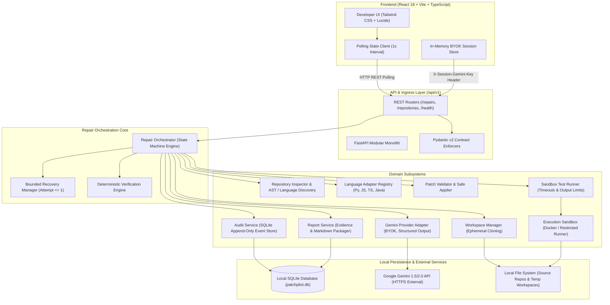

# PatchPilot — System Architecture & Modular Monolith Design

**Document Version:** 1.0.0-freeze  
**Status:** Approved Architecture Baseline  
**Architecture Style:** Modular Monolith (FastAPI) + Single-Page Application (React/Vite)  

---

## 1. High-Level Architectural Overview

PatchPilot is architected as a **Modular Monolith** running locally on the developer's workstation. It separates domain responsibilities into isolated, single-responsibility Python modules while avoiding the operational complexity, network latency, and serialization overhead of microservices.



---

## 2. Backend Module Boundaries & Ownership

Each module has a strict boundary, explicit dependency inputs, and zero circular dependencies.

```
+------------------------------------------------------------------------------------------------------+
|                                   MODULE BOUNDARY & RESPONSIBILITY MATRIX                            |
+--------------------------+----------------------------------------------------+----------------------+
| Module Name              | Primary Responsibility                             | Allowed Dependencies |
+--------------------------+----------------------------------------------------+----------------------+
| patchpilot.api           | HTTP routes, request/response lifecycle, headers   | schemas, orchestrator|
| patchpilot.schemas       | Pure Pydantic v2 models, enums, validators         | None (Leaf Module)   |
| patchpilot.orchestrator  | State machine transitions, repair job execution    | All Subsystems       |
| patchpilot.workspace     | Isolated directory cloning, path jail, cleanup    | schemas              |
| patchpilot.inspector     | Static file tree discovery, language heuristic     | schemas              |
| patchpilot.languages     | Language-specific test command generation          | schemas              |
| patchpilot.gemini        | Provider API interaction, prompt schemas, BYOK     | schemas              |
| patchpilot.patcher       | Unified diff syntax validation, atomic file patch  | schemas, workspace   |
| patchpilot.sandbox       | Process isolation (Docker / Restricted runner)     | schemas              |
| patchpilot.test_runner   | Test command dispatch, process timeout, output cap | sandbox, schemas     |
| patchpilot.verifier      | Deterministic truth engine, pass/fail evaluation   | schemas              |
| patchpilot.recovery      | Single-attempt recovery diagnostics, prompt repr   | schemas              |
| patchpilot.audit         | SQLite append-only audit event logging             | schemas, storage     |
| patchpilot.report        | Evidence compilation, diff & log bundle synthesis  | schemas, audit       |
| patchpilot.storage       | SQLite database connection, table schemas          | schemas              |
+--------------------------+----------------------------------------------------+----------------------+
```

### 2.1 Detailed Module Specifications

#### 1. API & Schemas (`patchpilot.api`, `patchpilot.schemas`)
* **Role:** Exposes versioned `/api/v1` REST endpoints.
* **Invariant:** Backend owns contract definition. Translates domain exceptions into PatchPilot's standard structured JSON error envelope (`APIError`), optimized for client error handling (rather than claiming RFC 7807 compliance).
* **Local API Protection:** Binds strictly to `127.0.0.1` (no listening on `0.0.0.0`). Configures narrow CORS allowing only the local Vite frontend origin (`http://localhost:5173`, `http://127.0.0.1:5173`) and validates Host headers to defend against unauthorized cross-origin requests across local loopback HTTP.
* **Path Privacy Invariant:** Never exposes absolute host filesystem paths to frontend responses; maps repositories by ID and displays safe relative paths.
* **Dependencies:** Only imports schemas and the orchestrator interface.

#### 2. Repair Orchestrator (`patchpilot.orchestrator`)
* **Role:** Coordinates the deterministic state machine (`queued` -> `inspecting` -> `reproducing` -> `patching` -> `testing` -> `verifying` -> `verified`/`unresolved`/`failed`).
* **Concurrency:** Runs jobs asynchronously using background tasks (`asyncio` / thread pool worker). Ensures a single active repair job per workspace to prevent disk collisions.

#### 3. Workspace Manager (`patchpilot.workspace`)
* **Role:** Provisions an ephemeral, isolated directory under system temporary storage (`tempfile.mkdtemp(prefix="patchpilot_ws_")`).
* **Safety Contract:**
  1. Deep-copies authorized source repository files, omitting `.git`, virtual environments, and transient artifacts.
  2. Resolves all paths with `Path.resolve()` to enforce strict directory jailing.
  3. Ensures total cleanup (`shutil.rmtree`) upon repair job termination.

#### 4. Repository Inspector (`patchpilot.inspector`)
* **Role:** Non-destructive static repository analysis.
* **Detection Matrix:**
  * Checks for `pyproject.toml`, `requirements.txt` -> sets language to `python`.
  * Checks for `package.json` -> inspects dependencies for `vitest`, `jest` -> sets language to `javascript` or `typescript`.
  * Checks for `pom.xml` -> detects Maven; checks for `build.gradle` -> detects Gradle -> sets language to `java`.

#### 5. Language Adapter Registry (`patchpilot.languages`)
* **Role:** Maps normalized test intent to concrete command arguments.
* **Interface:**
  ```python
  class LanguageAdapter(Protocol):
      def detect_test_framework(self, root: Path) -> TestFramework: ...
      def build_targeted_test_command(self, test_target: str) -> list[str]: ...
      def build_regression_test_command(self) -> list[str]: ...
  ```

#### 6. Gemini Provider Adapter (`patchpilot.gemini`)
* **Role:** Encapsulates the Google Gemini API client.
* **Contract:**
  1. Ingests session key passed via `X-Session-Gemini-Key` header or environment variable (`GEMINI_API_KEY`).
  2. Model is configurable via backend setting `GEMINI_MODEL` (default candidate: `gemini-2.0-flash` or `gemini-1.5-flash`). Model names in examples represent candidate defaults, not permanent guarantees of availability.
  3. Conducts active connection validation probe before repair initiation; user-supplied keys are never silently assumed valid upon submission.
  4. Enforces structured JSON output via system instructions and Gemini response schema validation.
  5. Translates provider HTTP 400/401 (Invalid Key), 404 (Unavailable/Deprecated Model), 429 (Resource / Rate Limit Exhausted), and 503 (Unavailable) errors into standardized domain exceptions. Explicitly accounts for free-tier quota limits (not unlimited).
  6. Keeps provider client behind a generic `ModelProvider` protocol to allow future provider pluggability.

#### 7. Patch Validator & Applier (`patchpilot.patcher`)
* **Role:** Validates candidate diffs prior to disk writes and applies them atomically.
* **Validation Criteria:**
  1. Verifies unified diff format (`--- a/...`, `+++ b/...`, `@@ -l,s +l,s @@`).
  2. Blocks modifications targeting files outside the workspace root.
  3. Checks that context lines match target file contents exactly.
  4. Applies changes atomically; creates backup snapshots (`.bak`) before touching workspace files, rolling back if application fails.

#### 8. Execution Sandbox (`patchpilot.sandbox`)
* **Role:** Isolates runtime test execution.
* **Tier 1 (Docker Sandbox):** Requires a 3-way feasibility check: (1) Docker CLI binary found in system PATH, (2) Docker daemon responds cleanly to ping (`docker info`), and (3) required language image exists locally (e.g. `patchpilot-sandbox:python-3.12`). Mounts workspace as a non-root volume; sets `--network none`; sets memory limit to 1024MB; enforces read-only container root.
* **Tier 2 (Restricted Demonstration Runner):** Permitted **strictly** for explicitly pre-authorized, trusted local fixtures. Command allowlisting alone is **not** treated as sufficient protection for arbitrary untrusted code. If Docker or the required image is unavailable and the target repository is untrusted or non-fixture, the backend **strictly refuses execution** (`SANDBOX_UNAVAILABLE`) rather than silently falling back to unsafe host execution. In Restricted Mode, sub-processes run with stripped environment variables (`PATH` and standard library paths only; secrets explicitly removed), command arguments are matched against strict allowlists (`pytest`, `vitest`, `npm test`, `./mvnw`, `./gradlew`), and an explicit restricted-mode warning is emitted in the UI and API.

#### 9. Sandbox Test Runner (`patchpilot.test_runner`)
* **Role:** Dispatches test commands through the active sandbox.
* **Guarantees:**
  * Hard wall-clock timeout (default 30 seconds for targeted, 60 seconds for regression).
  * Hard stdout/stderr output truncation at 64 KB to prevent buffer exhaustion.
  * Captures exit code, execution duration in milliseconds, termination status, and failure classification.

#### 10. Deterministic Verification Engine (`patchpilot.verifier`)
* **Role:** Sole authority for repair verification.
* **Rules of Truth:**
  $$\text{Verified} \iff \text{ValidBaselineFailure} \land (\text{TargetedTestExitCode} = 0) \land (\text{RegressionExitCode} = 0) \land (\text{DiffLength} > 0) \land \text{SourceRepoUnchanged}$$
  where:
  - $\text{ValidBaselineFailure} \iff (\text{BaselineExitCode} \neq 0) \land (\text{FailureType} = \text{"assertion\_failure"})$
  - A baseline failure caused by missing dependencies (`ImportError`), malformed target/collection failure (exit code 5), syntax error, runner crash, or timeout terminates as `failed`, never permitting patch generation.
  - If baseline test unexpectedly passes (exit code 0), repair terminates as `unresolved`.
  - Post-patch verification requires actual evidence: target test and full regression suite must both execute cleanly to exit code 0 with parsed passing assertions. Missing logs, execution timeouts, or ambiguous results strictly count as verification failure.
* **Invariant:** The model can never declare a repair verified. If regression tests fail, verification returns `unresolved` or triggers bounded recovery.

#### 11. Bounded Recovery Manager (`patchpilot.recovery`)
* **Role:** Handles repair failures safely without entering infinite loops.
* **Policy:**
  * Hard limit: $\text{Attempt} \le 1$.
  * If initial patch fails syntax validation: feeds error message back to model requesting syntax correction.
  * If patched test introduces regression: feeds regression failure logs back to model requesting surgical revision.
  * If second attempt fails: halts immediately, marking state as `unresolved`.

#### 12. Audit Service (`patchpilot.audit`)
* **Role:** Records append-only audit trail in SQLite.
* **Event Structure:** Stores `repair_id`, sequential index `sequence_id`, `event_type`, ISO 8601 `timestamp`, and JSON `payload`.

#### 13. Report Service (`patchpilot.report`)
* **Role:** Packages final repair evidence.
* **Artifacts:** Unified diff, baseline test failure log, patched test verification log, regression run log, execution time metrics, and confidence summary.

---

## 3. Component Dependency Graph (DAG)

To prevent architectural decay, PatchPilot enforces a strict Directed Acyclic Graph (DAG) with zero circular dependencies:

```
[api] ──> [schemas]
  │
  ├───> [orchestrator] ──> [schemas]
              │
              ├───> [workspace] ──> [schemas]
              ├───> [inspector] ──> [schemas]
              ├───> [languages] ──> [schemas]
              ├───> [gemini] ──> [schemas]
              ├───> [patcher] ──> [schemas], [workspace]
              ├───> [test_runner] ──> [sandbox] ──> [schemas]
              ├───> [verifier] ──> [schemas]
              ├───> [recovery] ──> [schemas]
              ├───> [audit] ──> [storage] ──> [schemas]
              └───> [report] ──> [audit], [schemas]
```

---

## 4. Database Schema (SQLite)

Local persistence is managed using SQLite (`patchpilot.db`). Foreign key enforcement is enabled via `PRAGMA foreign_keys = ON;`.

```sql
-- Repositories registered for local repair inspection
CREATE TABLE IF NOT EXISTS repositories (
    id TEXT PRIMARY KEY,                       -- UUID v4 (Exposed via API)
    name TEXT NOT NULL,                        -- Human readable identifier (Exposed via API)
    root_path TEXT NOT NULL UNIQUE,            -- Canonical path on host (INTERNAL ONLY: NEVER exposed over API)
    language TEXT NOT NULL,                    -- python, javascript, typescript, java, unknown
    test_framework TEXT NOT NULL,              -- pytest, vitest, jest, maven_junit, gradle_junit, unknown
    created_at TEXT NOT NULL                   -- ISO 8601 UTC
);

-- Repair jobs execution state
CREATE TABLE IF NOT EXISTS repairs (
    id TEXT PRIMARY KEY,                       -- UUID v4
    repository_id TEXT NOT NULL REFERENCES repositories(id) ON DELETE CASCADE,
    bug_report TEXT NOT NULL,                  -- User-provided problem description
    test_target TEXT,                          -- Optional specific test target/file
    status TEXT NOT NULL,                      -- queued, inspecting, reproducing, patching, testing, verifying, recovering, verified, unresolved, failed, cancelled
    recovery_attempts INTEGER NOT NULL DEFAULT 0, -- Max 1
    baseline_passed INTEGER,                   -- Boolean (0 or 1): must be 0 for valid reproduction
    baseline_failure_classification TEXT,      -- none, assertion_failure, import_error, collection_error, syntax_error, timeout, runner_crash
    targeted_passed INTEGER,                   -- Boolean (0 or 1): must be 1 after patch
    regression_passed INTEGER,                 -- Boolean (0 or 1): must be 1 after patch
    diff_text TEXT,                            -- Stored unified diff
    error_message TEXT,                        -- Diagnostic error if status is failed/unresolved
    started_at TEXT NOT NULL,                  -- ISO 8601 UTC
    completed_at TEXT                          -- ISO 8601 UTC
);

-- Append-only audit events for live polling and historical replay
CREATE TABLE IF NOT EXISTS audit_events (
    id TEXT PRIMARY KEY,                       -- UUID v4
    repair_id TEXT NOT NULL REFERENCES repairs(id) ON DELETE CASCADE,
    sequence_id INTEGER NOT NULL,              -- Monotonically increasing per repair: 1, 2, 3...
    event_type TEXT NOT NULL,                  -- state_transition, tool_call, tool_result, error, recovery_triggered
    payload TEXT NOT NULL,                     -- Structured JSON string
    created_at TEXT NOT NULL,                  -- ISO 8601 UTC
    UNIQUE(repair_id, sequence_id)
);

-- Formal verification records for evidence auditability
CREATE TABLE IF NOT EXISTS verification_records (
    id TEXT PRIMARY KEY,                       -- UUID v4
    repair_id TEXT NOT NULL REFERENCES repairs(id) ON DELETE CASCADE,
    outcome TEXT NOT NULL,                     -- verified, unresolved, failed
    baseline_exit_code INTEGER NOT NULL,
    targeted_exit_code INTEGER NOT NULL,
    regression_exit_code INTEGER NOT NULL,
    execution_duration_ms INTEGER NOT NULL,
    evidence_json TEXT NOT NULL,               -- Full stdout/stderr excerpts, hunk counts
    created_at TEXT NOT NULL                   -- ISO 8601 UTC
);

CREATE INDEX IF NOT EXISTS idx_repairs_repo ON repairs(repository_id);
CREATE INDEX IF NOT EXISTS idx_audit_events_repair ON audit_events(repair_id, sequence_id);
```

> [!CAUTION]
> **Zero API Key Persistence:** The database schema contains no table, column, or cache for provider API keys. Keys reside exclusively in process memory or host environment variables.

---

## 5. Intended Project Directory Structure

```
PatchPilot/
├── docs/                                  # Frozen Phase 0 Specifications
│   ├── PROJECT_SPEC.md
│   ├── ARCHITECTURE.md
│   ├── API_CONTRACT.md
│   ├── ACCEPTANCE_TESTS.md
│   ├── SECURITY.md
│   └── DEMO_RUNBOOK.md
├── backend/                               # Python 3.12+ Modular Monolith (FastAPI)
│   ├── pyproject.toml                     # Poetry / Pip / Packaging config
│   ├── patchpilot/
│   │   ├── __init__.py
│   │   ├── main.py                        # FastAPI entrypoint, middleware, lifespan
│   │   ├── api/                           # REST API layer (/api/v1)
│   │   │   ├── __init__.py
│   │   │   ├── deps.py                    # Session key & DB dependency injection
│   │   │   ├── router_health.py           # /health endpoint
│   │   │   ├── router_provider.py         # /provider/status, /provider/session-key
│   │   │   ├── router_repositories.py     # /repositories routes
│   │   │   └── router_repairs.py          # /repairs routes (lifecycle, diff, report)
│   │   ├── schemas/                       # Pydantic v2 domain schemas & enums
│   │   │   ├── __init__.py
│   │   │   ├── common.py                  # APIError, TimestampedEntity
│   │   │   ├── repository.py              # RepositoryCreate, RepositoryResponse
│   │   │   ├── repair.py                  # RepairCreate, RepairResponse, DiffResponse
│   │   │   ├── event.py                   # AuditEventResponse, ToolCallPayload
│   │   │   └── report.py                  # RepairReportResponse, VerificationEvidence
│   │   ├── orchestrator/                  # Workflow engine & state machine
│   │   │   ├── __init__.py
│   │   │   ├── state_machine.py           # Deterministic transition validator
│   │   │   └── repair_job.py              # Async execution coordinator
│   │   ├── workspace/                     # Ephemeral directory cloning & jailing
│   │   │   ├── __init__.py
│   │   │   └── manager.py                 # Safe file copy, cleanup, path resolver
│   │   ├── inspector/                     # Static repo inspection
│   │   │   ├── __init__.py
│   │   │   └── scanner.py                 # Language detection, file tree scanner
│   │   ├── languages/                     # Language adapters & test runners
│   │   │   ├── __init__.py
│   │   │   ├── base.py                    # LanguageAdapter protocol
│   │   │   ├── python_adapter.py          # pytest adapter
│   │   │   ├── javascript_adapter.py      # vitest / jest adapter
│   │   │   ├── typescript_adapter.py      # vitest / ts-jest adapter
│   │   │   └── java_adapter.py            # maven / gradle wrapper adapter
│   │   ├── gemini/                        # AI Model provider client
│   │   │   ├── __init__.py
│   │   │   ├── client.py                  # Gemini API SDK client / HTTP wrapper
│   │   │   └── prompts.py                 # Structured system instructions & schemas
│   │   ├── patcher/                       # Diff validation & patch engine
│   │   │   ├── __init__.py
│   │   │   ├── validator.py               # Unified diff syntax & bounds checker
│   │   │   └── applier.py                 # Atomic file patcher with rollback
│   │   ├── sandbox/                       # Process isolation layer
│   │   │   ├── __init__.py
│   │   │   ├── base.py                    # SandboxRunner protocol
│   │   │   ├── docker_runner.py           # Docker isolated container runner
│   │   │   └── restricted_runner.py       # Fallback process runner (fixtures only)
│   │   ├── test_runner/                   # Test execution dispatcher
│   │   │   ├── __init__.py
│   │   │   └── runner.py                  # Subprocess runner, timeout, 64KB cap
│   │   ├── verifier/                      # Deterministic verification engine
│   │   │   ├── __init__.py
│   │   │   └── engine.py                  # Matrix validation logic
│   │   ├── recovery/                      # Bounded retry manager (<= 1)
│   │   │   ├── __init__.py
│   │   │   └── manager.py                 # Diagnostics formulation & retry policy
│   │   ├── audit/                         # SQLite event store
│   │   │   ├── __init__.py
│   │   │   └── service.py                 # Event recorder & sequence generator
│   │   ├── report/                        # Final evidence packager
│   │   │   ├── __init__.py
│   │   │   └── builder.py                 # Report markdown / JSON compiler
│   │   └── storage/                       # Database engine
│   │       ├── __init__.py
│   │       ├── database.py                # SQLite connection pool / manager
│   │       └── models.py                  # Table definitions & migrations
│   └── tests/                             # Backend test suite (pytest)
│       ├── conftest.py
│       ├── test_api.py
│       ├── test_orchestrator.py
│       ├── test_workspace.py
│       ├── test_patcher.py
│       ├── test_verifier.py
│       └── test_security.py
├── frontend/                              # React 18 + Vite + TypeScript Frontend
│   ├── package.json
│   ├── tsconfig.json
│   ├── vite.config.ts
│   ├── tailwind.config.js
│   ├── src/
│   │   ├── main.tsx                       # React application root
│   │   ├── App.tsx                        # Main application container
│   │   ├── index.css                      # Tailwind base & dark theme tokens
│   │   ├── types/                         # Shared TypeScript types (mirrors API)
│   │   │   ├── api.ts
│   │   │   └── domain.ts
│   │   ├── api/                           # Typed API client layer
│   │   │   ├── client.ts                  # Fetch client with error handling
│   │   │   └── endpoints.ts               # Polling & mutation hooks
│   │   ├── hooks/                         # React hooks
│   │   │   ├── useRepairPolling.ts        # Polling state engine (1s interval)
│   │   │   └── useSessionKey.ts           # In-memory BYOK management
│   │   └── components/                    # Modular UI components
│   │       ├── Navbar.tsx                 # Header, connection badge, key setup
│   │       ├── GeminiKeyModal.tsx         # BYOK setup & connection test modal
│   │       ├── RepositorySelector.tsx     # Repo picker & language display
│   │       ├── BugReportForm.tsx          # Bug input & test target input
│   │       ├── RepairTimeline.tsx         # Live state machine progress stepper
│   │       ├── DiffViewer.tsx             # Syntax-highlighted unified diff
│   │       ├── TestOutputConsole.tsx      # Terminal test logs & verification badge
│   │       ├── FinalReportView.tsx        # Evidence-backed report download/view
│   │       └── Common/                    # Alerts, badges, buttons, spinners
│   │           ├── Badge.tsx
│   │           ├── Button.tsx
│   │           └── StatusIndicator.tsx
└── fixtures/                              # Controlled verification repositories
    ├── python_calc_bug/                   # Scenario A: Off-by-one discount bug
    ├── python_parser_bug/                 # Scenario B: Tokenizer edge-case bug
    └── python_regression_fixture/         # Scenario C: Fragile regression suite
```

---

## 6. Local Repository, Source Explorer & Dual-Mode Execution Architecture

### 6.1 Dual Operating Modes
1. **Trusted Demo Fixture Mode:** Bundled fixtures (`repo_py_calc_01`, `repo_py_parser_01`, `repo_py_regr_01`) are verified by fixture root path and database identity. These are authorized to run within ephemeral cloned workspaces via the restricted host test runner using allowlisted test commands.
2. **User Repository Inspection Mode:** When Docker is absent, untrusted user code execution is strictly rejected (`403 SANDBOX_UNAVAILABLE`). The backend permits safe static inspection, file viewing, and AI test proposal, but protects the developer workstation from arbitrary code execution.

### 6.2 Source Explorer & Code Viewer
- Safe file reading endpoint (`GET /api/v1/repositories/{id}/file`) resolves paths strictly inside the repository root jail.
- Traversal (`../`), symlink escapes, secret files (`.env*`, `.git`, `*.pem`, `*.key`), and binaries/oversized files are blocked.
- Line-numbered, syntax-formatted source display in frontend with instant copy and reload capabilities.

### 6.3 Test Discovery & Proposal Workflow
- Supports source-only projects lacking manifests or existing test suites (`layout_status: 'no_tests'`).
- AI test proposal (`POST /api/v1/repositories/{id}/propose-test`) analyzes source files and bug descriptions using Gemini (or deterministic stub) to formulate focused reproduction tests marked as `status: 'proposed'`.
- No host code execution is performed during test generation or review.

---

## 7. Desktop Application Architecture & Shell Selection

### 7.1 Desktop Shell Evaluation: Electron vs. Tauri
PatchPilot evaluated Tauri vs. Electron against the project constraints:
- **Tauri Evaluation:** While offering a lightweight Rust binary, Tauri requires the full Rust/Cargo toolchain (`rustc`, `cargo`, MSVC C++ build tools), which are not pre-installed on standard enterprise Windows developer workstations without administrative setup.
- **Electron Evaluation (Selected Architecture):** Runs on Node.js v24 and npm 11 already present on the workstation. It provides:
  1. **Genuine Native Windows Folder Selection:** Invokes `dialog.showOpenDialog({ properties: ['openDirectory', 'dontAddToRecent'] })`, returning authoritative absolute filesystem paths directly to the application without fake path masks (`C:\fakepath\`) or upload dialogues.
  2. **Child Process Lifecycle Management:** Spawns the local Python backend (`uvicorn patchpilot.main:app`), performs readiness polling against `/health`, handles port collisions by dynamically allocating a free port, and terminates the entire process tree on exit (`taskkill /pid <PID> /T /F` on Windows) to guarantee zero orphaned background processes.
  3. **Strict IPC Boundary:** Preload script (`preload.cjs`) runs with `contextIsolation: true` and `nodeIntegration: false`, exposing only explicit methods via `window.desktopApi`.
  4. **Production Asset Loading:** Securely serves packaged Vite production assets (`dist/index.html`) while connecting to the dynamically allocated backend port.

### 7.2 Desktop Process Lifecycle
```
[Application Launch]
        │
        ▼
[Check Port 8000] ──> Occupied by other process ──> [Find Free Port (e.g. 8001)]
        │                                                     │
        ▼ Available                                           ▼
[Spawn Python Backend: uvicorn 127.0.0.1:<port>]
        │
        ▼
[Poll /health endpoint until 200 OK (max 30s)]
        │
        ▼
[Create BrowserWindow & Load dist/index.html]
        │
        ▼
[Preload injects window.desktopApi with resolved API base URL]
        │
[User interacts with Native Windows Directory Dialog & Local Repos]
        │
        ▼
[Application Close / Window Closed / SIGINT]
        │
        ▼
[taskkill /pid <Python_PID> /T /F -> Process Tree Terminated -> Exit]
```

---

## 8. Autonomous Bug Discovery Architecture

### 8.1 Scanner Architecture
In addition to directed repair with user-supplied bug descriptions, PatchPilot provides autonomous bug discovery (`patchpilot.inspector.autonomous_scanner`):
1. **Source Inventory & Layout Discovery:** Identifies source files, modules, and test configurations without user prompts.
2. **AST & Pattern Analysis:** Analyzes Python ASTs and source patterns for:
   - Boundary condition strict inequality faults (`>` vs `>=`).
   - Parser dropped token loops and infinite conditions.
   - Non-zero return value assumptions (e.g. exit codes).
   - Bare `except:` clauses swallowing unexpected runtime errors.
   - Mutable default arguments (`def func(x=[])`).
3. **Test Correlation:** When an existing test suite is present, runs baseline tests via `RestrictedRunner` on the unmodified workspace. Failing boundary tests elevate findings from `likely` to `confirmed` with deterministic test evidence.
4. **Candidate Fix Pipeline:** When `auto_prepare_fix=True` or the developer clicks **Find Bugs & Prepare Fixes**, findings are immediately dispatched into disposable workspaces to synthesize and verify candidate patches.

---

## 9. Patch Application & Approval Gate

### 9.1 Original Repository Immutability
Candidate patches are generated and verified exclusively inside disposable workspaces (`tempfile.mkdtemp`). The developer's original repository is strictly read-only during investigation, generation, baseline reproduction, targeted verification, regression testing, and recovery.

### 9.2 Approval Gate Actions
1. **Approve and Export:** The user explicitly reviews the unified diff and verification evidence. `POST /api/v1/repairs/{id}/export` checks that original files have not been modified externally since snapshot creation, applies the unified diff to the authoritative repository root, validates written files, and transitions status to `VERIFIED`.
2. **Reject Changes:** `POST /api/v1/repairs/{id}/reject` transitions status to `UNRESOLVED` and emits audit event `PATCH_REJECTED`. The original repository remains completely unmodified.
3. **Review Diff:** Inspects unified diff hunks with line-by-line syntax highlighting.
4. **Keep Report Without Exporting:** Closes the report dialog while preserving audit records in SQLite without modifying the project files.


