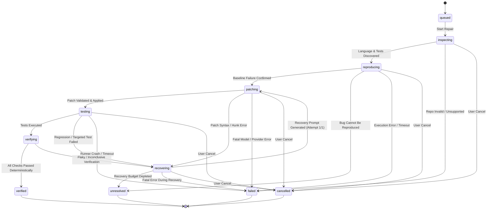

# PatchPilot — Project Specification

**Document Version:** 1.0.0-freeze  
**Status:** Approved Architecture Baseline  
**Product Category:** AI Software Delivery Agent  
**Scope:** Phase 0 Specification & System Contract  

---

## 1. Executive Summary & Product Mission

### 1.1 Product Name & Category
**PatchPilot** is a purpose-built **AI Software Delivery Agent** designed for autonomous, verified software repair within controlled local developer environments.

### 1.2 Product Promise
> **"From bug report to tested, reviewable repair — in one controlled workflow."**

PatchPilot ingests a bug report, inspects an authorized local codebase, localizes and reproduces the failure, synthesizes a targeted source patch, validates and applies the patch inside an isolated ephemeral workspace, executes both targeted and regression test suites, deterministically verifies the outcome, and packages an evidence-backed audit report for developer review.

### 1.3 Differentiation from Conversational Chatbots
Standard conversational coding assistants offer speculative explanations, unstructured markdown snippets, or blind command execution. PatchPilot rejects this paradigm. It is an operational delivery agent built on four foundational capabilities:

```
+-----------------------------------------------------------------------------------+
|                               PATCHPILOT CORE PILLARS                            |
+---------------------+---------------------+------------------+--------------------+
|       1. ACT        |      2. REPEAT      |    3. VERIFY     |     4. RECOVER     |
| Controlled tools,   | Deterministic state | Deterministic    | Bounded recovery,  |
| isolated workspaces,| machine, auditable  | test evaluation; | clean degradation, |
| zero source-repo    | lifecycle, explicit | model NEVER      | zero infinite      |
| mutation.           | event sequence.     | declares success.| retry loops.       |
+---------------------+---------------------+------------------+--------------------+
```

1. **ACT:** Interacts with repository files exclusively through constrained, strictly validated tools operating in an ephemeral workspace. Never modifies the user's primary source directory.
2. **REPEAT:** Follows an automated multi-step state machine with explicit lifecycle phases, persistent event logging, and state replayability.
3. **VERIFY:** Evaluates test execution output deterministically. An AI model is forbidden from deciding whether a repair succeeded; pass/fail criteria are strictly governed by test exit codes, output assertion matching, and regression baselines.
4. **RECOVER:** Detects syntax invalidity, patch application rejection, test regressions, provider rate-limiting, and execution timeouts, executing at most one bounded recovery attempt before terminating safely.

---

## 2. Fixed Scope & Boundary Commitments

### 2.1 Supported Target Languages
PatchPilot provides explicit support for four language ecosystems, with Python as the primary reference implementation:

| Language | Ecosystem Tooling & Detection | Test Execution Strategy | Scope Boundary & Limitations |
| :--- | :--- | :--- | :--- |
| **Python** *(Reference)* | `pyproject.toml`, `setup.cfg`, `requirements.txt`, `pytest.ini` | `pytest` runner with targeted node IDs (`pytest path/to/test.py::test_fn`) | Requires existing virtual environment or pre-installed runtime. No automated package installation. |
| **JavaScript** | `package.json`, `npm`, `yarn`, `pnpm` | Existing project test script or configured `vitest` / `jest` | Uses existing node_modules. Will not run `npm install`. |
| **TypeScript** | `package.json`, `tsconfig.json` | Existing project test script or configured `vitest` / `jest` (ts-node / ts-jest) | Uses existing node_modules and tsconfig. Transpilation errors treated as test failures. |
| **Java** | `pom.xml` (Maven), `build.gradle` / `build.gradle.kts` (Gradle) | Maven Wrapper (`./mvnw test`) or Gradle Wrapper (`./gradlew test`) executing JUnit | Requires wrapper in repo or host runtime. Detection does not guarantee proprietary build layouts. |

> [!IMPORTANT]
> **No Automatic Dependency Installation:** PatchPilot operates exclusively against repositories with pre-configured dependencies. The agent will neither run `pip install`, `npm install`, nor download Gradle dependencies dynamically during repair execution. Language detection indicates structural recognition, not universal build support.

### 2.2 Technology Stack
* **Backend:** Python 3.12+ (subject to environment compatibility), FastAPI, Pydantic v2, SQLite (via standard library / aiosqlite), Uvicorn, pytest.
* **Frontend:** React 18+, Vite, TypeScript, Tailwind CSS, Lucide React icons.
* **Architecture Style:** Modular Monolith. Clean boundary separation across internal Python packages without microservice overhead.
* **AI Provider:** Google Gemini API (BYOK - Bring Your Own Key). Model is configurable via backend setting `GEMINI_MODEL` (default candidate: `gemini-2.0-flash` or `gemini-1.5-flash`). Model names represent default candidates, not permanent guarantees of availability. User-supplied keys are validated upon submission; free tier quotas are not assumed to be unlimited.
* **Storage:** Local SQLite database storing repair metadata, audit events, verification records, and diff artifacts. Secrets are strictly omitted from disk storage.
* **Local Loopback Security:** Local HTTP loopback (`127.0.0.1`) does not provide TLS encryption; backend binds exclusively to `127.0.0.1`, enforces narrow CORS restricted to authorized local frontend origins, and validates Host headers to prevent unauthorized cross-origin requests from arbitrary web pages.

### 2.3 Explicit MVP Non-Goals
* **No Authentication / Multi-Tenancy:** Single-developer, local workstation execution only.
* **No Git / Remote Mutations:** No automatic `git commit`, `git push`, branch creation, or GitHub PR creation. Repositories are treated as local directory trees.
* **No Blind Shell Execution:** The model cannot propose arbitrary shell scripts. All actions are executed via strict, predefined tool schemas.
* **No Remote Cloud Deployments:** PatchPilot is engineered for local, secure edge execution.

---

## 3. Repair Lifecycle State Machine

The repair lifecycle is governed by a strict deterministic state machine. State transitions are linear, auditable, and immutable once a terminal state is reached.



### 3.1 State Definitions & Transition Criteria

| State | Classification | Description & Transition Logic |
| :--- | :--- | :--- |
| `queued` | Transient | Repair request recorded in SQLite; awaiting orchestrator dispatch. |
| `inspecting` | Active | Clones source repo to ephemeral workspace; runs `inspect_repository` to detect language, file tree, test framework, and relevant files. |
| `reproducing` | Active | Executes `run_targeted_test` in unmodified workspace. Evaluates baseline outcome:<br>1. **Valid Reproduction (Permits Patching):** Test runner executes cleanly; target test node fails with genuine assertion/expectation failure (e.g. `AssertionError`); no import/syntax/runner errors. -> Transitions to `patching`.<br>2. **Unreproducible Bug:** Target test unexpectedly passes (exit code 0). -> Transitions to `unresolved`.<br>3. **Infrastructure Failure:** Missing dependencies (`ImportError`/`ModuleNotFoundError`), malformed target, no tests collected (pytest code 5), runner crash, or timeout. -> Transitions to `failed`. |
| `patching` | Active | Calls Gemini provider with structured bug context; generates candidate patch; executes `validate_patch` and `apply_patch` in ephemeral workspace. |
| `testing` | Active | Executes `run_targeted_test` followed by `run_regression_tests` within the patched workspace. Captures exit codes, stdout, stderr, and run duration. |
| `verifying` | Active | Deterministic verification engine analyzes post-patch test results. Requires actual test evidence: target test passed, full regression suite passed with zero errors/failures, non-empty diff, and source repo integrity verified. Missing evidence, timeout, runner abort, or ambiguous logs strictly count as verification failure. |
| `recovering` | Active | Bounded recovery manager triggers if patch fails to apply or tests fail. Allows exactly **one** recovery cycle (`attempt <= 1`). Formulates error feedback for the model and loops back to `patching`. |
| `verified` | **Terminal (Success)** | Deterministic engine confirms all required evidence: (1) valid baseline assertion failure reproduced, (2) post-patch targeted test executed and passed (exit code 0), (3) post-patch regression suite executed and passed (exit code 0, 0 failures), (4) patch non-empty and valid. |
| `unresolved` | **Terminal (Inconclusive)** | Repair concluded without crash, but verification conditions were not satisfied (e.g. bug unreproducible on baseline, or 1/1 recovery attempt failed). Original repository untouched. |
| `failed` | **Terminal (Error)** | Unrecoverable infrastructure failure (e.g. missing dependency / `ImportError`, invalid test target, execution timeout, quota exhausted, invalid API key, sandbox unavailable). |
| `cancelled` | **Terminal (Aborted)** | User explicitly triggered `/api/v1/repairs/{id}/cancel`. Immediate process SIGTERM/SIGKILL sent to running sandbox. |
| `approval-pending` | Optional Staging | Staging state reserved exclusively for external operations (e.g. exporting diff to source repo). **Never interrupts or gates the internal ephemeral repair loop.** |

---

## 4. Controlled Agent Tool Specifications

The AI agent interacts with the workspace exclusively through high-level, structured tools implemented in trusted Python application code. The model cannot execute raw bash or manipulate OS primitives directly.

```
+----------------------------------------------------------------------------------+
|                            CONTROLLED TOOL PROTOCOL                              |
+-------------------------+--------------------------------------------------------+
| Tool Identifier         | Responsibility & Execution Boundary                    |
+-------------------------+--------------------------------------------------------+
| inspect_repository      | Scans workspace root; extracts file tree & tooling.    |
| read_file               | Reads bounded file content; path jail enforced.        |
| run_targeted_test       | Executes specific test file or test node ID.          |
| propose_patch           | Synthesizes unified diff or structured search/replace. |
| validate_patch          | Verifies patch syntax, file bounds, and hunk offsets.  |
| apply_patch             | Applies verified patch to ephemeral workspace.         |
| run_regression_tests    | Executes suite-wide regression test suite.             |
| verify_repair           | Deterministic validation engine evaluation.            |
| record_event            | Emits structured audit event to SQLite log.           |
+-------------------------+--------------------------------------------------------+
```

### 4.1 Detailed Tool Signatures

#### `inspect_repository`
* **Input:** `{ "repository_id": str }`
* **Execution:** Scans file tree (ignoring `.git`, `node_modules`, `__pycache__`, `.venv`). Detects configuration files (`pyproject.toml`, `package.json`, `pom.xml`, etc.).
* **Output:** `{ "language": str, "framework": str, "file_count": int, "entry_files": list[str], "test_files": list[str] }`

#### `read_file`
* **Input:** `{ "file_path": str, "offset_line": int = 1, "limit_lines": int = 500 }`
* **Validation:** Resolves canonical path; enforces directory jail within ephemeral workspace. Blocks symlink traversal.
* **Output:** `{ "file_path": str, "total_lines": int, "content": str }`

#### `run_targeted_test`
* **Input:** `{ "test_target": str, "timeout_seconds": int = 30 }`
* **Execution:** Dispatches command through execution sandbox (`pytest <target>`, `npm test -- <target>`, `./mvnw test -Dtest=<target>`).
* **Output:** `{ "exit_code": int, "stdout": str, "stderr": str, "passed": bool, "duration_ms": int, "timed_out": bool, "failure_classification": "none" | "assertion_failure" | "import_error" | "collection_error" | "syntax_error" | "timeout" | "runner_crash" }`

#### `propose_patch`
* **Input:** `{ "description": str, "diff": str }`
* **Execution:** Model returns candidate unified diff or structured replacements for review by `validate_patch`.
* **Output:** `{ "patch_id": str, "raw_diff": str, "target_files": list[str] }`

#### `validate_patch`
* **Input:** `{ "patch_id": str }`
* **Execution:** Performs dry-run parsing. Verifies target files exist, hunk headers (`@@ -l,s +l,s @@`) align with existing file lines, and no path traversal tokens (`..`) exist.
* **Output:** `{ "is_valid": bool, "syntax_errors": list[str], "modified_files": list[str] }`

#### `apply_patch`
* **Input:** `{ "patch_id": str }`
* **Execution:** Atomic application of diff to workspace. Backs up affected files prior to write. Rolls back on partial write failure.
* **Output:** `{ "applied": bool, "modified_files": list[str], "hunks_applied": int }`

#### `run_regression_tests`
* **Input:** `{ "test_suite_scope": str = "all", "timeout_seconds": int = 60 }`
* **Execution:** Runs project regression test suite inside patched workspace. Enforces output truncation at 64KB.
* **Output:** `{ "exit_code": int, "tests_run": int, "tests_passed": int, "tests_failed": int, "stdout_summary": str }`

#### `verify_repair`
* **Input:** `{ "repair_id": str }`
* **Execution:** Trusted Python engine checks matrix:
  1. Baseline was cleanly reproduced with an explicit domain assertion failure (not infrastructure/import/timeout error).
  2. Post-patch targeted test executed completely and passed (exit code 0, assertion verified).
  3. Post-patch regression suite executed completely and passed (exit code 0, 0 failures, 0 errors).
  4. Non-empty validated unified diff was applied.
  5. Source repository checksum matches original state.
  *(Any missing log evidence, timeout, or ambiguity immediately yields `unresolved` or `failed`, never `verified`).*
* **Output:** `{ "outcome": "verified" | "unresolved" | "failed", "evidence_summary": dict }`

#### `record_event`
* **Input:** `{ "repair_id": str, "event_type": str, "payload": dict, "sequence_id": int }`
* **Execution:** Appends audit record to SQLite database with ISO 8601 UTC timestamp.
* **Output:** `{ "recorded": bool, "event_id": str }`

---

## 5. Security & Trust Boundaries

```
+-----------------------------------------------------------------------------------+
|                            TRUST BOUNDARY ISOLATION                               |
|                                                                                   |
|  [ HOST ENVIRONMENT ]                                                             |
|   +----------------------------------------------------------------------------+  |
|   | Source Repository (C:/Projects/App)                                        |  |
|   |   * READ-ONLY Access. Zero writes permitted.                               |  |
|   +----------------------------------------------------------------------------+  |
|                                | Safe Ephemeral Clone                             |
|                                v                                                  |
|   +----------------------------------------------------------------------------+  |
|   | Ephemeral Workspace (C:/Temp/patchpilot_ws_abc123)                        |  |
|   |   * Directory Jailed. Disposable. Cleaned on repair termination.           |  |
|   |   * Process Execution in Sandbox (Docker / Restricted Runner).             |  |
|   |   * Command Allowlists (pytest, npm test, mvnw, gradlew).                  |  |
|   |   * Network Disabled (--network none). API Keys Stripped from Env.         |  |
|   +----------------------------------------------------------------------------+  |
|                                ^                                                  |
|                                | Controlled JSON Protocol                         |
|   +----------------------------------------------------------------------------+  |
|   | PatchPilot Backend Orchestrator (FastAPI / Python 3.12)                     |  |
|   |   * Enforces Tool Allowlist, Validates Diff Syntax, Verifies Tests.       |  |
|   +----------------------------------------------------------------------------+  |
|                                | TLS HTTPS (BYOK)                                 |
|                                v                                                  |
|  [ EXTERNAL PROVIDER ]                                                            |
|   +----------------------------------------------------------------------------+  |
|   | Google Gemini API (Model Provider)                                         |  |
|   |   * Receives bug description & code snippets.                              |  |
|   |   * Explicit privacy warning disclosed to user.                            |  |
|   +----------------------------------------------------------------------------+  |
+-----------------------------------------------------------------------------------+
```

### 5.1 Workspace Protection
* **Source Repository Immutability:** Original source files are treated as read-only assets. An ephemeral copy is created inside a dedicated workspace root for every repair job.
* **Directory Jail Enforcement:** All file operations are canonicalized against the ephemeral workspace root via `pathlib.Path.resolve()`. Any path resolving outside this directory raises `PathTraversalSecurityException`.
* **Symlink Traversal Prevention:** Symlinks pointing outside the workspace boundary are rejected and quarantined.

### 5.2 Process Execution Sandbox & Feasibility Policy
* **Tier 1 (Docker Sandbox):** Requires a 3-way feasibility check: (1) Docker CLI executable exists in system PATH, (2) Docker daemon is reachable and responding (`docker info`), and (3) the required language container image exists locally (e.g. `patchpilot-sandbox:python-3.12`). Standard execution runs inside isolated, non-root containers with `--network none`, read-only root filesystems, memory caps (1GB), and CPU limits.
* **Tier 2 (Restricted Demonstration Runner):** Permitted **only** for explicitly pre-authorized, trusted local fixtures. Command allowlisting alone is **not** considered sufficient protection for arbitrary untrusted code. If Docker or the required image is unavailable and the user requests repair of an untrusted or non-fixture repository, PatchPilot **strictly refuses execution** (`SANDBOX_UNAVAILABLE`) rather than silently falling back to unsafe host execution. When running authorized fixtures in Restricted Mode, a persistent warning is displayed, secrets (`GEMINI_API_KEY`, host tokens) are completely stripped from child process environments, command arguments are matched against strict allowlists, and execution is bound by strict process timeouts.

### 5.3 BYOK & Local API Security
* **Session-Only Frontend Retention:** The frontend retains the user-supplied Gemini API key strictly in React component memory for the active browser session. It is never stored in browser `localStorage`, `sessionStorage`, or cookies.
* **Active Submission Validation:** A submitted key is never silently assumed valid; `POST /api/v1/provider/session-key` conducts an active validation probe with the Gemini API.
* **Loopback Transmission Protections:** Keys are sent only to the local backend over the configured loopback connection (`127.0.0.1`) via the `X-Session-Gemini-Key` header, unless configured via the backend `GEMINI_API_KEY` environment variable. Because local loopback HTTP is not TLS, the backend binds strictly to `127.0.0.1`, enforces narrow CORS restricted to authorized local frontend origins, and validates Host headers to reject unauthorized cross-origin requests.
* **Zero Backend Persistence & Redaction:** API keys are never written to SQLite, configuration files, or logs. Request logging, error reporting, tracing, and audit events redact all tokens matching API key patterns.

---

## 6. Success Metrics & Verification Integrity

1. **Zero False Positives:** Under no circumstances may PatchPilot present an inconclusive or unverified repair as "verified". If a test was not run, it is reported as `not_run`. If a test timed out, it is treated as a verification failure.
2. **Determinism:** Given the same repository fixture, bug report, and patch proposal, the verification engine must always return the exact same verification verdict.
3. **Traceability:** Every state transition and tool output produces an immutable audit record containing ISO 8601 UTC timestamps and structured payloads.
